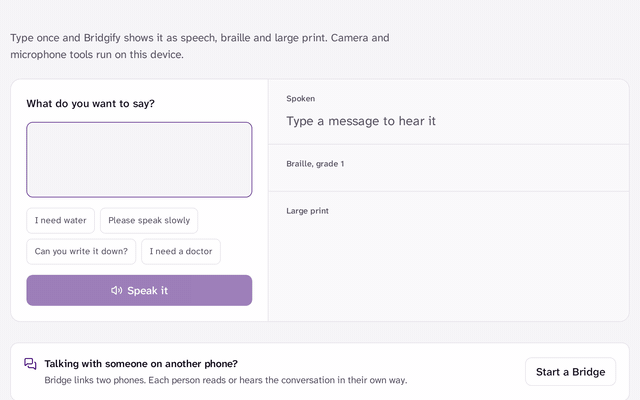
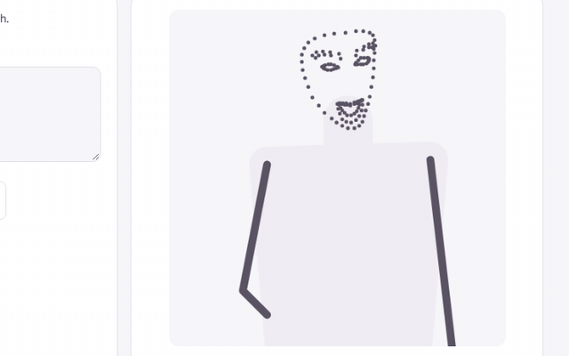
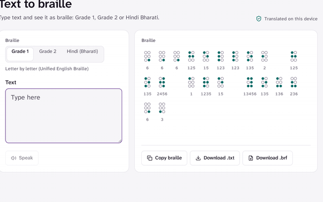
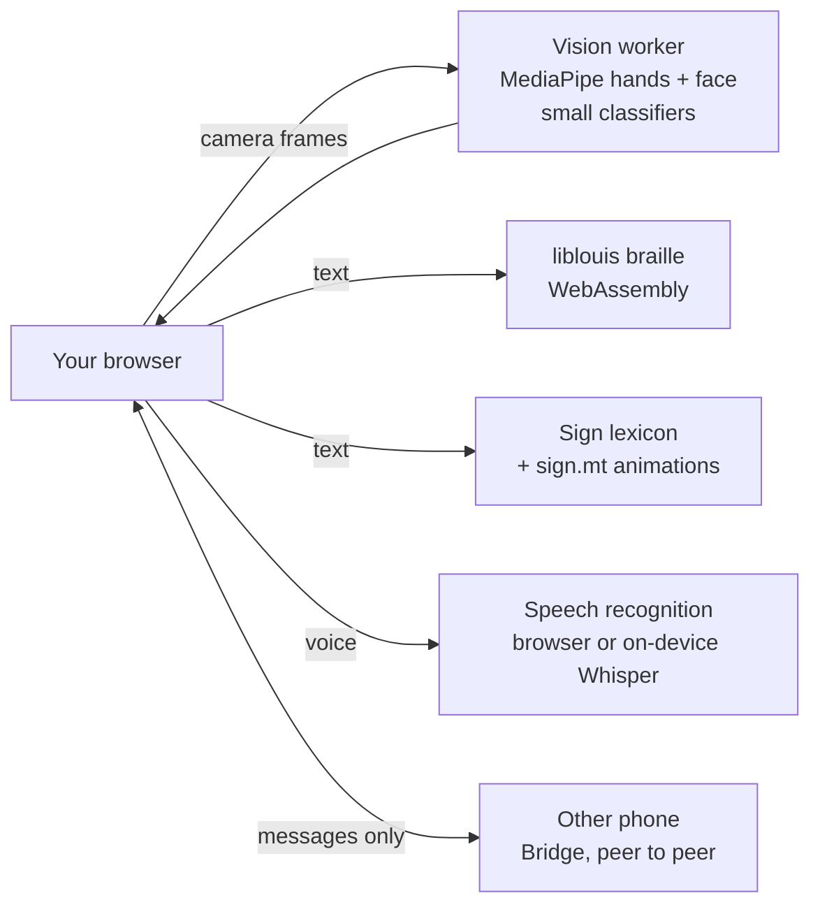

<div align="center">



<br>

**A free website that lets people talk across speech, text, braille and sign language.**
**Built for people who are Deaf, hard of hearing, mute, blind, autistic or dyslexic, and for everyone around them.**

<br>

[](https://bridgify-vcet.vercel.app)


<br>

<table>
<tr>
<td align="center" width="33%"><br><b>Type once, see it every way</b></td>
<td align="center" width="33%"><br><b>Text to sign in six sign languages</b></td>
<td align="center" width="33%"><br><b>Braille in and out</b></td>
</tr>
</table>

<br>

[**Open the website**](https://bridgify-vcet.vercel.app) &nbsp;·&nbsp;
[**User guide (PDF)**](docs/Bridgify-User-Guide.pdf) &nbsp;·&nbsp;
[**How well it works**](https://bridgify-vcet.vercel.app/about/evidence) &nbsp;·&nbsp;
[**Project docs**](docs/00-START-HERE.md)

<sub>Mini project, Semester VI Computer Engineering, Vidyavardhini's College of Engineering &amp; Technology (University of Mumbai), 2025–26.<br>Riddhi Mehta, Vedika Misal, Siddhi Bhosale, Om Panjari. Mentor: Prof. Manali Payghan.</sub>

</div>

<br>

## Every page, one click away

| What you want to do | Open | What happens |
|---|---|---|
| Say something every way at once | [Home](https://bridgify-vcet.vercel.app/) | Type a message. It is shown as speech, braille, fingerspelling and large print |
| Have text read aloud | [Text to speech](https://bridgify-vcet.vercel.app/tools/text-to-speech) | Type or tap a phrase. It is spoken, and each word lights up as it is said |
| See what someone is saying | [Speech to text](https://bridgify-vcet.vercel.app/tools/speech-to-text) | Live captions with punctuation added. Big captions view for across the table |
| Turn text into braille | [Text to braille](https://bridgify-vcet.vercel.app/tools/text-to-braille) | Grade 1, Grade 2 or Hindi braille, with dot pictures and downloads |
| Write braille | [Braille to text](https://bridgify-vcet.vercel.app/tools/braille-to-text) | Press S D F J K L together like a Perkins brailler, or tap dots |
| Fingerspell to the camera | [Sign to text](https://bridgify-vcet.vercel.app/tools/sign-to-text) | ASL or ISL letters are read from your hand, on your device |
| See words signed | [Text to sign](https://bridgify-vcet.vercel.app/tools/text-to-sign) | An animated signer in ISL, ASL, FSL, LSM, LIS or DGS |
| Show a gesture or expression | [Gesture and emotion](https://bridgify-vcet.vercel.app/tools/gesture-emotion) | Thumbs up, open palm, wave and more are recognised and can be spoken |
| Talk to someone on another phone | [Bridge](https://bridgify-vcet.vercel.app/bridge) | Two phones, one conversation. Each person reads or hears it their own way |
| Get help fast | [SOS](https://bridgify-vcet.vercel.app/sos) | A full-screen emergency card in large text, braille and sign. Works offline |
| Learn braille | [Learn braille](https://bridgify-vcet.vercel.app/learn/braille/alphabet) | Alphabet, numbers, Grade 2 contractions and a quiz |
| Learn sign language | [Learn sign language](https://bridgify-vcet.vercel.app/learn/sign/isl/alphabet) | Everyday phrases in six sign languages; alphabets for ISL, ASL, FSL and DGS; numbers for ISL and ASL; camera practice for ISL and ASL |
| Change how it looks | Display settings (left menu) | 12 modes: dyslexia, autism-friendly, low vision, high contrast and more |
| Check the numbers | [Evidence](https://bridgify-vcet.vercel.app/about/evidence) | Accuracy measured on people the models never saw |

<br>

## How to use it

The full step-by-step guide, with screenshots and a test checklist, is in the **[user guide (PDF)](docs/Bridgify-User-Guide.pdf)**. Here is the short version.

**Before you start**
- Use **Chrome or Edge** on a laptop or Android phone. Safari works too. In Brave, turn on "on-device recognition" on the Speech to text page.
- When a page asks for the **camera or microphone**, press **Allow**. Nothing is recorded, and camera pictures never leave your device.
- To use it like an app, open the menu in your browser and choose **Install** or **Add to Home screen**.

<details>
<summary><b>Home: say it every way</b></summary>

1. Open [the home page](https://bridgify-vcet.vercel.app/).
2. Type in **What do you want to say?**, or tap a phrase under the box.
3. Press **Speak it** to hear it. The braille dots, fingerspelling pictures and large print update as you type.
</details>

<details>
<summary><b>Text to speech</b></summary>

1. Open [Text to speech](https://bridgify-vcet.vercel.app/tools/text-to-speech).
2. Type your message, or tap a quick phrase (Common words, Phrases, Emergency…). Phrases speak straight away.
3. Change **Language** (English or Hindi), **Voice** and **Speed** if you like.
4. Press **Speak**. The live caption highlights each word. Use **Pause**, **Stop** or **Repeat**.
</details>

<details>
<summary><b>Speech to text</b></summary>

1. Open [Speech to text](https://bridgify-vcet.vercel.app/tools/speech-to-text).
2. Press **Start listening** and allow the microphone. Speak normally.
3. Words appear with punctuation. Press **Captions view** for large text to show someone.
4. **Speak**, **Copy**, **Download** or **Clear** the transcript.
5. In Brave, or in a noisy room, press **Download and turn on** under "On-device recognition" (about 40 MB, once).
</details>

<details>
<summary><b>Text to braille and Braille to text</b></summary>

1. Open [Text to braille](https://bridgify-vcet.vercel.app/tools/text-to-braille). Choose **Grade 1**, **Grade 2** or **Hindi (Bharati)**.
2. Type text. The braille dots appear underneath with their dot numbers.
3. **Copy braille**, **Download .txt** (a log of everything you converted) or **Download .brf** (for embossers).
4. Open [Braille to text](https://bridgify-vcet.vercel.app/tools/braille-to-text). Click the dashed box and press **S D F J K L** together for one cell, then release. On a phone, tap the dots and press **Add cell**.
</details>

<details>
<summary><b>Sign to text</b></summary>

1. Open [Sign to text](https://bridgify-vcet.vercel.app/tools/sign-to-text). Choose **ISL** or **ASL**.
2. Press **Start camera** and allow the camera. The first time it downloads about 12 MB.
3. Hold a letter steady. The ring fills and the letter is added after about 0.7 seconds.
4. Use **Space** between words, then **Speak** to say the word aloud. If it is unsure, tap one of its three guesses.
</details>

<details>
<summary><b>Text to sign</b></summary>

1. Open [Text to sign](https://bridgify-vcet.vercel.app/tools/text-to-sign). Choose a sign language.
2. Type words, or tap a quick phrase. Press **Show signs**.
3. The signer plays each word. Use **Play/Pause**, the arrows, **Speed** and **Loop**. Unknown words are fingerspelled.
</details>

<details>
<summary><b>Gesture and emotion</b></summary>

1. Open [Gesture and emotion](https://bridgify-vcet.vercel.app/tools/gesture-emotion) and press **Start camera**.
2. Show a thumbs up, open palm, peace sign, fist, pointing finger, I-love-you or a wave.
3. Turn on **Speak meanings aloud** to hear "Yes, I agree" and so on. Your expression is shown too (approximate).
</details>

<details>
<summary><b>Bridge: two phones, one conversation</b></summary>

1. On phone A open [Bridge](https://bridgify-vcet.vercel.app/bridge), choose how you want to receive messages and press **Start a conversation**. A six-character code and a QR code appear.
2. On phone B scan the QR code, or open Bridge, type the code under **Join with a code** and press **Join**.
3. Each person picks how they **send** (type, speak, quick phrases, fingerspell) and how they **receive** (captions, speech, braille, sign).
4. Messages arrive in the other person's chosen form. Press **Leave** to end it for both.
5. Only one laptop? On the waiting screen press **Open it in another tab on this device**.
</details>

<details>
<summary><b>SOS</b></summary>

1. Press the red **SOS** button on any page.
2. Find the card you need, such as "I am Deaf. Please write it down." Press **Speak** to say it, **Show full screen** to hold it up, or **Sign it** to play the signs.
3. Under **Your details**, add your emergency contact once. After that a **Call** button rings them, and **Share my location** sends a map link. The cards work offline.
</details>

<details>
<summary><b>Display settings (12 modes)</b></summary>

1. Open **Display settings** (bottom of the left menu, or the sliders icon on a phone).
2. Pick a mode: Light, Dark, High contrast, Solarized, Night blue, Forest, Sepia, Calm, Focus, Low vision, Autism-friendly or Dyslexia.
3. Change **Text size**, hide tools you don't use, underline links, use a large cursor or turn off animation. Settings are saved on your device.
</details>

<br>

## Test it yourself in five minutes

| # | Do this | You should see |
|---|---|---|
| 1 | [Text to braille](https://bridgify-vcet.vercel.app/tools/text-to-braille): type `HELLO, HOW ARE YOU?` | Braille cells with dot numbers; Grade 2 shortens `THE RED FORT` |
| 2 | [Text to sign](https://bridgify-vcet.vercel.app/tools/text-to-sign): ASL, `hello`, **Show signs** | The signer raises a hand to the forehead |
| 3 | [Sign to text](https://bridgify-vcet.vercel.app/tools/sign-to-text): ASL, **Start camera**, hold up the letter L | `L` appears after the ring fills |
| 4 | [Text to speech](https://bridgify-vcet.vercel.app/tools/text-to-speech): Emergency → *Call an ambulance* | It is spoken right away |
| 5 | [Speech to text](https://bridgify-vcet.vercel.app/tools/speech-to-text): **Start listening**, say "where is the hospital" | `Where is the hospital?`, with the question mark added |
| 6 | Display settings → **Dyslexia** | The whole site switches to OpenDyslexic with wider spacing |
| 7 | [Bridge](https://bridgify-vcet.vercel.app/bridge) on two phones | A message typed on one appears on the other |

The [user guide](docs/Bridgify-User-Guide.pdf) has the full checklist of 40+ checks.

<br>

## How it works



- **Everything runs in your browser.** Camera pictures never leave your device, and nothing about you is stored on a server. Speech to text uses the browser's own speech service, or the on-device model if you turn it on. The only server code is a small voice fallback for text to speech.
- **Light and fast.** The first load is about 122 KB of JavaScript (gzip). Models download only on the page that needs them, once, and are then cached for offline use.
- **Measured, not claimed.** Letters were tested on signers the models never saw: ASL **0.962**, ISL **0.989** macro-F1. See [Evidence](https://bridgify-vcet.vercel.app/about/evidence) and [`docs/EVAL.md`](docs/EVAL.md).

More detail:
- [System architecture](docs/03-SYSTEM/SYSTEM-ARCHITECTURE.md)
- [Machine learning pipeline](docs/03-SYSTEM/ML-PIPELINE.md)
- [Design system](docs/03-SYSTEM/DESIGN-SYSTEM.md)
- [Requirements](docs/02-PRODUCT/PRD.md)
- [Updates for the report](docs/REPORT-UPDATES.md)

<br>

## Run it on your computer

```bash
git clone https://github.com/RidzM/bridgify.git
cd bridgify/web
pnpm install          # also copies the MediaPipe runtime into public/
pnpm dev              # http://localhost:5173
```

| Command (in `web/`) | What it does |
|---|---|
| `pnpm test` | Unit and parity tests (braille, speech, vision, sign) |
| `pnpm build` | Production build, plus a size budget and a security policy check |
| `pnpm e2e` | Browser tests on desktop and phone sizes, including accessibility in all 12 modes |
| `SLOW=1 pnpm e2e` | Also runs the real camera and on-device Whisper tests |

To retrain or re-check the models, follow [`ml/README.md`](ml/README.md): `cd ml && uv sync`, download the public datasets with `scripts/download.sh`, then run the listed training and evaluation steps.

<br>

## What's inside

```
web/       the website (React 18, Vite, TypeScript)
  src/engines/    speech, braille, vision, sign and bridge logic
  src/features/   one folder per page
  public/models/  hand, face and letter models
  public/signs/   sign animations and fingerspelling pictures
ml/        training and evaluation of the on-device models
content/   phrases, lexicons, tutorials and credits
docs/      requirements, architecture, evaluation, user guide
server/    optional self-hosted API (braille reference tests)
```

<br>

## Credits and licence

Code is MIT-licensed. Data, models, fonts and sign media keep their own licences. They are listed on the [credits page](https://bridgify-vcet.vercel.app/about/credits) and in `content/CREDITS.json`. Bridgify recognises fingerspelling and looks signs up word by word. It does not translate sign language and is not a substitute for a qualified interpreter.
