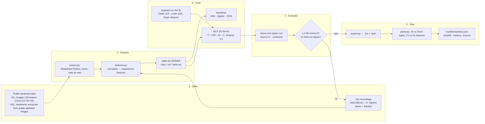

# ML pipeline

> **Goal:** real, measured on-device recognition, with the **smallest possible download**.
>
> **Rule:** ML ships only where the report needs it, and every model loads only on the page that uses it `[CONFIRMED]`.
>
> Visual version: `../diagrams/ml-pipeline.html`.

## 1. What runs, and what it weighs

| Model | Used by | Type | Size | Ships? |
|---|---|---|---|---|
| MediaPipe **HandLandmarker** (`hand_landmarker.task`, float16) | Sign→Text, Gesture, Practice, Bridge "show hands" | Pretrained (Google), as-is | 7.8 MB | Yes. Lazy, cached once |
| MediaPipe **FaceLandmarker** (`face_landmarker.task`, with blendshapes) | Emotion | Pretrained (Google), as-is | ~3.7 MB | Yes. Lazy, only on Gesture & Emotion |
| **ASL letter MLP** (ours) | Sign→Text (ASL) | Trained by us | ~100 KB | Yes |
| **ISL letter MLP** (ours) | Sign→Text (ISL) | Trained by us | ~120 KB | Yes |
| Gesture classifier | Gesture & Emotion | **Rules on landmarks** (no model) | 0 | — |
| Emotion scorer | Gesture & Emotion | **Weighted rules on blendshapes**, weights tuned on our data | 1 KB JSON | — |
| Whisper tiny.en (q8) | STT fallback | Pretrained, via transformers.js | ~40 MB | **Opt-in only** |
| ~~GestureSign word model~~, ~~Holistic~~, ~~Human~~, ~~onnxruntime-web~~, ~~Piper~~ | — | — | 5–25 MB each | **Cut** `[DECISION D-08, D-03, D-05]` |

**Runtime:** MediaPipe's own WASM, plus about 60 lines of JS for the MLP forward pass (`web/src/engines/vision/mlp.ts`). No TF.js, ONNX Runtime or other ML library.

## 2. End-to-end flow



## 3. Data

### 3.1 Sources (revision 2, 24 Nov: public data only, D-27)

| Need | Primary | Signers / people | Licence | Size | Held-out plan |
|---|---|---|---|---|---|
| ASL letters | HF `juanjodurillo/asl-hg` (ASL-HG) | 10, with a `participant_id` column (P1–P10) | CC-BY-4.0 | ~1.1 GB parquet | Train P1–P7, val P8, **test P9–P10** |
| ASL letters (extra test) | Pugeault & Bowden "Dataset A" (`cvssp.org/FingerSpellingKinect2011/fingerspelling5.tar.bz2`, or Kaggle `mrgeislinger/asl-rgb-depth-fingerspelling-spelling-it-out`) | 5 (A–E) | Research use | 2.25 GB | Cross-dataset test on a different camera and people |
| ISL letters | Kaggle `dwibonbhargabdeka/isl-dataset-mediapipe-hand-landmarks` | 6 train + 1 held-out file | CC-BY-SA-4.0 | 25 MB | Their held-out signer file. Columns are wrist-relative xyz, left then right, with zeros for a missing hand; **re-scale to our features** |
| ISL letters (extra test) | Mendeley ISLAN `rc349j45m5` | 6, organised by signer | CC-BY-4.0 | small | Cross-dataset check |
| Gestures | Kaggle `kapitanov/hagrid` annotations (21 **2D** landmarks + `user_id`) | 95+ users | CC-BY-SA-4.0 | 354 MB, no images | Tune the rules on a held-out set of users. Mapping: like→thumbs up, dislike→thumbs down, palm/stop→open palm, one→pointing, peace, fist. There is no I-love-you set, so that rule is checked with a manual test |
| Emotion | KDEF (Kaggle `muhammadnafian/kdef-dataset`), frontal and half-profile views | 70 people | Non-commercial research | 509 MB | Tune the blendshape weights on 50 people, **test on 20** |

Our own recordings are **not** used (Q-08). The collector page stays as an optional lab tool.

### 3.1a Original plan (superseded)

| Set | Contents | Licence | Use |
|---|---|---|---|
| Kaggle `dwibonbhargabdeka/isl-dataset-mediapipe-hand-landmarks` | ISL, 23 static letters (no H, J, Y), 126 features (2 hands × 21 × xyz), 6 signers + 1 held out | CC BY-SA 4.0 | ISL training and benchmark |
| Kaggle `prathumarikeri/indian-sign-language-isl` | ISL images A–Z, 1–9 | CC BY-SA 4.0 | Extract landmarks for H/Y and digits if needed |
| Kaggle `grassknoted/asl-alphabet` | ASL images, 29 classes, single signer, 87k images | GPL-2 (dataset) | ASL pre-training only (it generalises poorly on its own) `[ASSUMED: licence fine for a non-commercial student model; Q-07]` |
| **Our collector** | ASL 24 static + ISL 23 static, ≥ 5 signers, ≥ 120 frames per letter per signer, varied light, both hands for ASL | Team-owned | Main training data and the **held-out test signers** |

The collector data matters most. Public single-signer sets overfit, and held-out-signer accuracy is the number that proves the model works.

### 3.2 Collector (`/lab/collector`, unlinked)

- **Flow:**
  1. Signer ID and handedness.
  2. Language.
  3. For each letter: a reference image, a 3-2-1 countdown, then 4 s of capture at ~30 fps.
  4. Automatic rejection of frames with no hand or low hand score (< 0.7).
- **Storage:** raw landmarks only, never images, in IndexedDB `samples`. Each sample:

  ```json
  {signer, lang, label, ts, handedness[], landmarks: [[21×3], [21×3]?], worldLandmarks?, device, light:"bright|dim"}
  ```

- **Export:** `.jsonl.gz` download, dropped into `ml/data/raw/collector/`.
- **Consent line on screen:** "Only hand-point coordinates are saved, never video." This makes data collection privacy-safe for friends who volunteer.

## 4. Features (identical in Python and TypeScript)

The spec lives in one place, `ml/bridgify_ml/features.py`. It is mirrored by `web/src/engines/vision/features.ts`, and the two are kept identical by the parity test.

For each hand (21 landmarks, image-normalised x, y, z):
1. **Translate** so the wrist (0) is the origin.
2. **Scale** by the distance from the wrist (0) to the middle-finger MCP (9).
3. **Mirror** left hands to right (x → −x), using geometry rather than the handedness label for ISL two-hand slots. The slot order is decided by which hand is image-left.
4. **Down-weight z** (× 0.5); it is the noisiest axis.
5. Engineered features:
   - 15 finger-joint angles (3 per finger)
   - 10 fingertip pairwise distances
   - palm normal (3)

Per-hand vector: 63 + 15 + 10 + 3 = **91**.

- **ASL:** F = 91.
- **ISL:** F = 91 × 2 + 2 (presence mask) = **184**. A missing hand is a zero block with mask = 0.
- **Standardise** with the training-set mean and std, exported with the weights.

## 5. Training

- **Env:** `ml/` with `uv` on Python 3.12, CPU only, `torch`, `mediapipe`, `scikit-learn`, `numpy`, `pandas`, `pyyaml`.
- **Model:** `Linear(F,128) → ReLU → Dropout(0.2) → Linear(128,64) → ReLU → Dropout(0.2) → Linear(64,C)`.
  - About 25k parameters.
  - Float32 weights are about 100 KB.
- **Optimiser:**
  - AdamW, lr 3e-3, weight decay 1e-4, cosine schedule
  - 60 epochs, batch 256
  - label smoothing 0.05
  - early stopping on val macro-F1
- **Augmentation** (in feature space, before the engineered features):
  - in-plane rotation ±15°
  - scale 0.9–1.1
  - Gaussian jitter σ = 0.01
  - random finger dropout (zero 1 finger, p = 0.1)
  - small z noise
- **Baselines** (sanity check, logged): kNN (k=5), logistic regression, RBF-SVM. The MLP should beat logistic regression by ≥ 3 points of macro-F1, or we ship the simpler model.
- **Emotion weights:** a small grid search over the rule weights (§6 of the architecture) on the team's own 7-emotion clips (each person acts each emotion for 5 s). Objective: macro-F1 on held-out people. Reported honestly, because acted emotions are not real ones.
- **Gesture rules:** thresholds tuned on the team's 8-gesture recordings. Target ≥ 90% accuracy.

## 6. Evaluation (published on `/about/evidence` and in `docs/EVAL.md`)

| Metric | How | Gate |
|---|---|---|
| Macro-F1, held-out signer | Leave-one-signer-out across collector signers. For ISL, also Dwibon's held-out signer | **≥ 0.90** for ASL and ISL static letters |
| Per-letter F1 + confusion matrix | On the held-out set | Letters < 0.80 are listed as known weak (often M/N/S/T in ASL) |
| Live commit accuracy | 3 people spell 10 words each in the app; count correct committed letters | ≥ 85% |
| Latency | `inferMs` (landmarker + MLP) median and p95 in the browser, on a laptop and a phone | MLP < 1 ms. Full frame < 40 ms on a laptop |
| Gesture accuracy | 3 people × 8 gestures × 5 tries | ≥ 90% |
| Emotion macro-F1 | Acted clips, held-out people | Reported, no gate. UI says "approximate" |

Every run writes `ml/runs/<date>-<name>/report.json` (config, split, metrics, confusion, git SHA). The chosen run is copied to `docs/EVAL.md` and to `web/public/models/manifest.json` (`metrics`).

## 7. Export and parity

- **`export.py`** writes:
  - `asl-letters.bin`: concatenated Float32 weights and biases, little-endian
  - `asl-letters.json`: `{version, labels[], featureSpec:"v1", F, layers:[[in,out],…], mean[], std[], sha256}`
- **`mlp.ts`** loads both and does `x = (x-mean)/std`, then dense → ReLU → dense → ReLU → dense → softmax.
- **`parity.py`** + `features.parity.test.ts`:
  1. Python writes `fixtures/features.json` (20 raw landmark frames, expected features and logits).
  2. Vitest computes the same in TS.
  3. The check passes if max abs diff < 1e-5 for features and < 1e-4 for logits.

  This is the guard against "works in Python, wrong in the browser".

## 8. Runtime (in the browser)

- **Frame loop:** `vision.worker` runs landmarker → features → MLP → probs.
- **Main thread:** EMA smoothing (α = 0.35) → committer state machine (SYSTEM-ARCHITECTURE §8.3).
- **Thresholds:** commit at p ≥ 0.80 held 700 ms. Release at p < 0.65. Repeats need a change or a hand drop. These are constants in `committer.ts`, tunable in the lab page.
- **J and Z** (motion letters): not in the static model. The UI marks them "motion letter: type it or use the keyboard". *Stretch:* a trajectory rule on index or pinky tip.
- **Low-confidence UX:** "Not sure" plus the top-3 candidates as tappable chips. Tapping one commits it, which also helps people with atypical hand shapes.

## 9. Ownership and versioning

- Models are versioned in `manifest.json` (`asl-letters@1.0.0`). Changing the feature spec bumps `featureSpec`, and old weights are refused at load.
- The training data (collector exports) is kept by the team, outside git (privacy). Only aggregate metrics are published.
