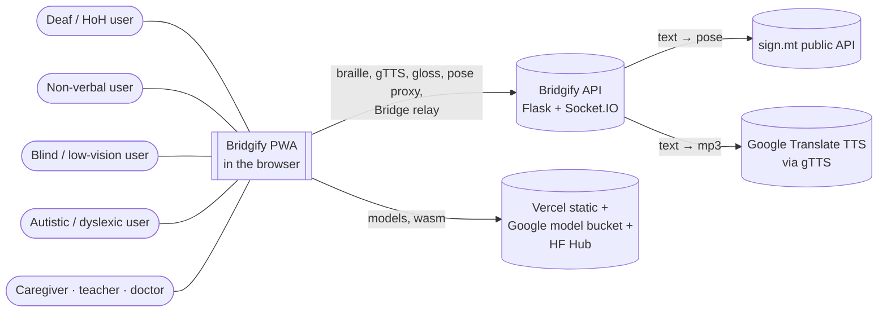
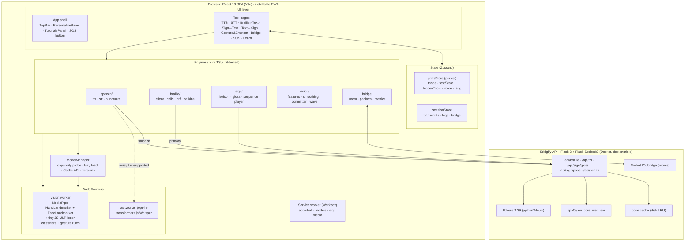
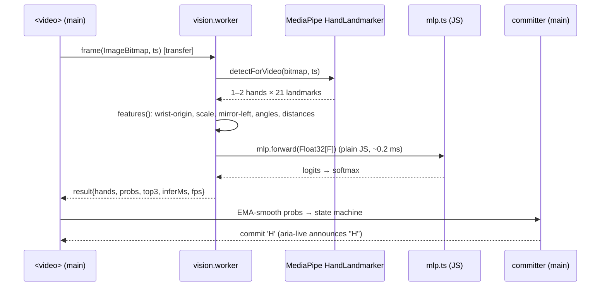
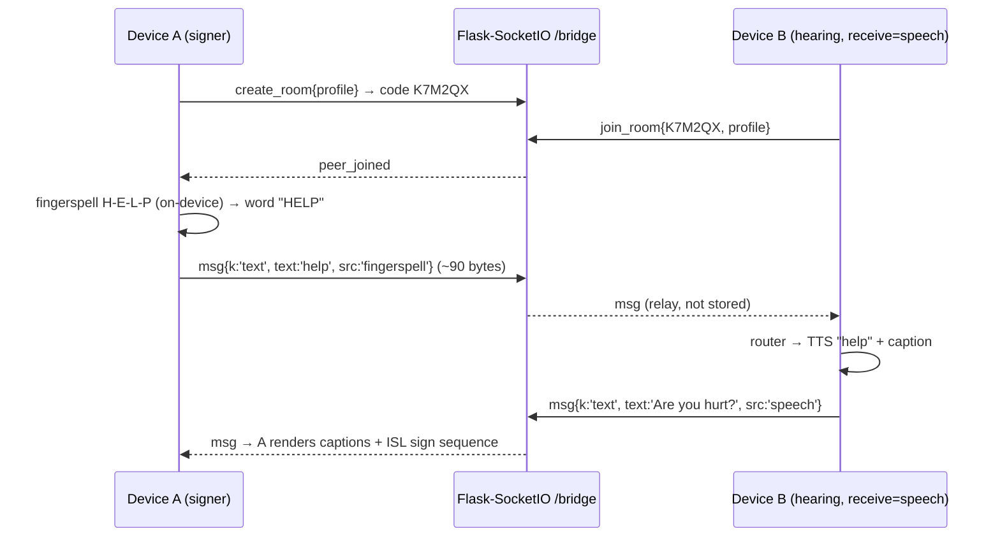
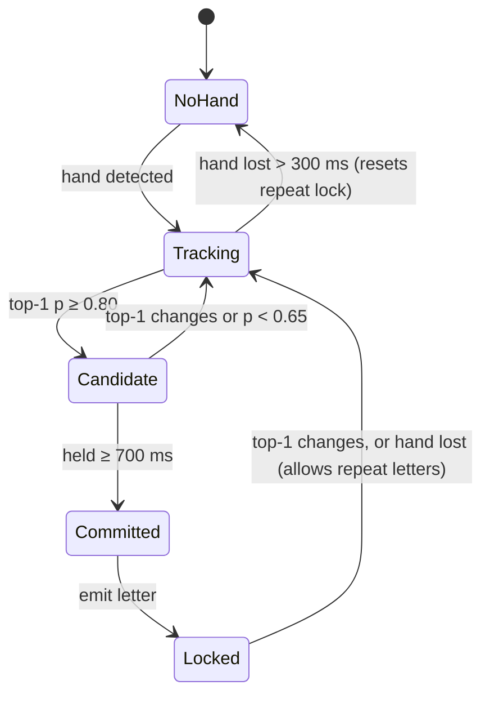

# Bridgify v2: system architecture

> **Read with:**
> - `../02-PRODUCT/PRD.md`: the *what*, with FR IDs.
> - `ML-PIPELINE.md`: models, data, training, evaluation.
> - `DESIGN-SYSTEM.md`: look, tokens, 12 modes.
> - `../04-DELIVERY/BUILD-PLAN.md`: the *how, in order*.
> - `../01-BUSINESS/RESEARCH.md`: every library and source choice, with links.
>
> **Visual versions:**
> - `../diagrams/system-architecture.html`
> - `../diagrams/ml-pipeline.html`
> - `../diagrams/bridge-sequence.html`
>
> Open them locally in a browser.
>
> **State:** see `../04-DELIVERY/CURRENT-STATE.md`.
>
> **Deployment change (D-24, 24 Nov):** there is **no always-on server** in production.
> - Braille: liblouis runs as **WebAssembly in the browser**.
> - gTTS: a small **Flask function on Vercel** (`web/api/`).
> - ISL gloss: rules run in the browser.
> - Bridge: **WebRTC peer-to-peer** via the free PeerJS broker.
>
> The Flask + Socket.IO server described in §7 stays in `server/` as a self-hostable reference and the source of the liblouis golden tests. Where §6–§8 say "server", read the D-24 mapping above.

---

## 1. Principles

1. **Device first.** Camera, mic and ML run in the browser. The server only does what a browser can't do well:
   - canonical liblouis
   - gTTS
   - gloss parsing
   - relaying Bridge rooms
2. **Every tool has a fallback chain.** No dead ends (NFR-06). Each fallback is shown to the user.
3. **Engines are separate from UI.** Each capability is a plain TypeScript module with a typed API and unit tests (`src/engines/*`). React components only render the engines.
4. **Heavy work runs in workers.** Vision and Whisper run in Web Workers, so the UI thread stays at 60 fps and INP stays low.
5. **Light by default.** The shell is tiny (≤ 180 KB JS). A tool page loads its own code and models on first visit and caches them. Only three model files ever ship: the hand landmarker (7.8 MB), the face landmarker (3.7 MB) and two letter classifiers (~100 KB each). Whisper is an opt-in download. No ML runtime library is bundled beyond MediaPipe's own WASM `[CONFIRMED]`.
6. **Accessible by construction.**
   - Semantic HTML first, ARIA only where needed.
   - Every live output has an `aria-live` region.
   - All 12 modes are CSS-variable themes, not separate components.
7. **Honest ML.** Every prediction carries a confidence, and below threshold the UI says "not sure". Metrics are published.
8. **Keep it small.** Two deployables (web and server), one ML workspace, one content folder. No database, no auth, no message queue. Nothing in this design needs them.

---

## 2. Context



No other external systems. No analytics, no auth provider, no database. `[DECISION D-01]`

---

## 3. High-level architecture



---

## 4. Tech stack, with reasons

Versions are as of 24 Nov 2026. Pin exact versions in `package.json` and `requirements.txt`.

### 4.1 Web (`web/`)

| Concern | Choice | Version | Why |
|---|---|---|---|
| Framework | **React** | 18.3.1 | The report says React 18. Stable, and every library supports it |
| Build | **Vite** | 8.3.x | Fast dev and builds, native worker and WASM support. The report says Vite |
| Language | TypeScript (strict) | 5.9 or 7.0 | Typed engine APIs. If 7.0 tooling misbehaves, pin 5.9 `[ASSUMED]` |
| Routing | **React Router DOM** | 6.30.x | The report says v6. Data routers, lazy routes |
| State | **Zustand** + `persist` | 5.1.x | The report says Zustand. Tiny, no boilerplate, hydrates synchronously from localStorage (no wrong-theme flash) |
| Styling | **Tailwind CSS 4** + CSS variables | 4.3.x | Tokens in CSS variables, so one class set themes across 12 modes |
| Primitives | **Base UI** (`@base-ui/react`) | 1.9.x | Unstyled, accessible dialogs, menus, sliders, switches, tabs. We style them ourselves (not the stock shadcn look) |
| Motion | **Motion** (formerly Framer Motion) | 14.x | The report says Framer Motion. Used sparingly, and gated by `useReducedMotion` plus the mode |
| Icons | lucide-react | 1.x | Consistent stroke icons. Each one gets an accessible label |
| Fonts | Fontsource: **Syne** (display), **Atkinson Hyperlegible Next** (body), **OpenDyslexic** (dyslexia mode), Noto Sans scripts (on demand) | 5.3.x | Self-hosted (offline, no Google Fonts request). Atkinson was made by the Braille Institute for low-vision readers |
| Hand and face vision | **@mediapipe/tasks-vision** | 1.2.3 | HandLandmarker (sign letters + gestures) and FaceLandmarker with blendshapes (emotion). One runtime for all vision. Pin the WASM path to the same version |
| Classifier runtime | **None: our own `mlp.ts`** (Float32 matmul + ReLU + softmax, about 60 lines) | — | The letter MLPs are tiny (~25k params), so a runtime library (onnxruntime-web is ~10 MB of WASM) is not worth it `[DECISION D-03]` |
| Emotion | MediaPipe FaceLandmarker blendshapes, then `emotion.ts` scorer | — | Same runtime as the hands. Transparent rules, labelled approximate `[DECISION D-05]` |
| ASR fallback (opt-in) | **@huggingface/transformers** | 4.3.2 | `onnx-community/whisper-tiny.en` (~40 MB q8), loaded only after the user agrees. Its chunk is dynamically imported, so it is never in the main bundle |
| Sign pose render | **pose-viewer** web component (+ `pose-format`) | 1.2.0 | Renders sign.mt `.pose` files and our Bridge landmark streams |
| Realtime | **socket.io-client** | 4.8.x | Matches Flask-SocketIO (the report says Socket.IO) |
| Storage | `idb-keyval` | 6.3.x | Session logs, collected samples, pose cache. Small and promise-based |
| PWA | **vite-plugin-pwa** (Workbox) | 2.0.x | Precaches the shell, runtime-caches models and media |
| QR | qrcode.react | 4.2.x | Bridge room QR |
| Tests | **Vitest** 5, **Playwright** 1.65 + **@axe-core/playwright** 4.14, Lighthouse CI 0.16 | | Unit, e2e, accessibility and performance gates |
| Lint/format | ESLint (typescript-eslint, jsx-a11y, react-hooks), Prettier | | `jsx-a11y` catches accessibility bugs at write time |
| Design QA | **Impeccable** CLI (`npx impeccable detect`) | | Catches template-looking UI and rendered contrast problems in CI |

### 4.2 Server (`server/`)

| Concern | Choice | Version | Why |
|---|---|---|---|
| Framework | **Flask** (app factory + blueprints) | 3.1.3 | The report says Flask |
| Realtime | **Flask-SocketIO** in `threading` mode with **simple-websocket** | 5.7.2 / 1.1.0 | Real WebSocket transport without eventlet/gevent (both are poorly maintained on Python 3.13+) |
| WSGI | **gunicorn**, 1 worker, `--threads 50` | 27.x | One worker keeps rooms in memory (no Redis needed at this scale) `[DECISION D-13]` |
| CORS | Flask-CORS | 6.0.5 | Allowlist: the Vercel domain and localhost |
| Rate limiting | Flask-Limiter (in-memory) | 4.1.x | Protects gTTS and pose proxying |
| Braille | **liblouis 3.39** via Debian `python3-louis` + `liblouis-data` (trixie-backports) | 3.39.0 | Real UEB G1/G2 and Bharati. **Never `pip install louis`**: that PyPI package is unrelated |
| TTS fallback | gTTS | 2.5.4 | The report says gTTS. Responses cached by hash |
| Gloss | **spaCy** `en_core_web_sm` | 3.8.x | Dependency parse for ISL SOV reordering. ~15 MB model, fits in 512 MB |
| Python | 3.13 (Debian trixie system Python) | | Matches the `python3-louis` binding |
| Lint/test | Ruff, pytest, pytest-socketio-style tests via `socketio.test_client` | | |

### 4.3 ML (`ml/`)

| Concern | Choice | Why |
|---|---|---|
| Env | `uv` with **Python 3.12** (separate from the server) | Torch and MediaPipe wheels exist for 3.12 |
| Landmark extraction (offline datasets) | `mediapipe` Python (Tasks API), same `hand_landmarker.task` as the web | Same model on both sides, so training and runtime features match |
| Training | **PyTorch** 2.x (CPU is enough) + scikit-learn baselines | MLP on ~100–200 features trains in minutes |
| Export | `export.py` writes `{layers:[{W,b}], labels, featureSpec, mean, std}` as **Float32 binary + JSON header** (~100 KB), plus a parity test: JS forward pass vs Torch logits | No runtime needed in the browser |
| Tracking | Plain JSON run reports in `ml/runs/<date>-<name>/` + `docs/EVAL.md` | Simple and reviewable. No MLflow needed |

### 4.4 Why not Rust, Go or a microservice split

Every hot path already runs native code:
- MediaPipe is C++ compiled to WASM.
- liblouis is C.
- Whisper (opt-in) runs on ONNX.

The JavaScript and Python around them is glue. A Rust layer would add a toolchain and complexity with no measurable speed gain. Speed comes from workers, lazy loading, caching and on-device inference, not from the glue language. `[DECISION D-02]`

---

## 5. Repository layout

```text
bridgify/
├── README.md                               what it is, how to run, links to docs
├── docs/                                   PRD, architecture, ML pipeline, design system, build plan, evaluation
├── web/                                    React SPA (deploys to Vercel)
│   ├── index.html
│   ├── vite.config.ts                      PWA, worker format 'es', optimizeDeps excludes for wasm
│   ├── public/
│   │   ├── models/                         manifest.json + asl-letters.bin/json + isl-letters.bin/json + mediapipe *.task (self-hosted)
│   │   ├── wasm/                           mediapipe tasks-vision wasm (copied at build)
│   │   └── signs/                          curated sign media (webm/mp4/webp), per language
│   └── src/
│       ├── main.tsx · app/                 router.tsx, Providers.tsx, AppShell.tsx, ErrorBoundary.tsx
│       ├── design/                         tokens.css, modes.css (12 [data-mode] blocks), fonts.ts, motion.ts
│       ├── components/                     ui/ (Button, Chip, Slider, Switch, Dialog, Tabs, Panel, Toast…), shell/, media/
│       ├── features/
│       │   ├── home/ · personalize/ · tutorials/ (panel + pages) · sos/ · bridge/ · evidence/ · collector/
│       │   ├── tts/ · stt/ · braille/ (text-to-braille, braille-to-text) · sign-to-text/ · text-to-sign/ · gesture-emotion/
│       ├── engines/                        framework-free logic, each with index.ts + *.test.ts
│       │   ├── speech/ (tts.ts, stt.ts, punctuate.ts, whisperClient.ts, voices.ts, wordTiming.ts)
│       │   ├── braille/ (api.ts, grade1.ts, cells.ts, brf.ts, perkins.ts, tables.ts)
│       │   ├── vision/ (camera.ts, visionClient.ts, features.ts, mlp.ts, smoothing.ts, committer.ts, gestures.ts, wave.ts, emotion.ts, labels.ts)
│       │   ├── sign/ (lexicon.ts, tokenize.ts, glossClient.ts, poseClient.ts, sequence.ts, fingerspell.ts)
│       │   ├── bridge/ (socket.ts, room.ts, packets.ts, metrics.ts, router.ts)
│       │   └── platform/ (capabilities.ts, modelManager.ts, cache.ts, storage.ts, permissions.ts, brave.ts)
│       ├── workers/                        vision.worker.ts, asr.worker.ts
│       ├── stores/                         prefs.ts, session.ts, bridge.ts
│       └── content/ → ../../content (Vite alias @content)
├── server/                                 Flask API (Docker)
│   ├── Dockerfile · gunicorn.conf.py · requirements.txt · pyproject.toml (ruff, pytest)
│   ├── bridgify/                           __init__.py (create_app), config.py, extensions.py (socketio, limiter, cors)
│   │   ├── api/ braille.py · tts.py · sign.py · health.py
│   │   ├── realtime/ bridge.py
│   │   └── services/ louis_svc.py · gloss_svc.py · pose_proxy.py · tts_svc.py
│   └── tests/                              test_braille_golden.py, test_gloss.py, test_bridge_socket.py, test_limits.py
├── ml/                                     training workspace (never deployed)
│   ├── pyproject.toml (uv, py3.12) · README.md
│   ├── data/ raw/ (git-ignored) · processed/ · splits/
│   ├── bridgify_ml/ extract.py · features.py · augment.py · datasets.py · models.py · train.py · evaluate.py · export.py · parity.py
│   ├── configs/ asl_letters.yaml · isl_letters.yaml
│   └── runs/ (git-ignored) → reports copied to docs/EVAL.md
├── content/                                curated data, shared by web (+ server tests)
│   ├── lexicons/ asl.json · isl.json · lsf.json · lsm.json · lis.json · dgs.json
│   ├── phrases/ quick-access.{en,hi,fr,es,it,de}.json · sos.json
│   ├── tutorials/ braille-g1.json · braille-g2.json · fingerspelling/{lang}.json · numbers/{lang}.json · phrases/{lang}.json
│   ├── scripts/ indic-22.json                   letter equivalents in the 22 scheduled-language scripts
│   └── CREDITS.json                             every external asset: source, licence, author, url
└── .github/workflows/ ci.yml                    web lint+test+build, server ruff+pytest, e2e+axe, impeccable detect
```

---

## 6. Frontend architecture

### 6.1 Routes

All routes are lazy (`React.lazy` + route `lazy`).

| Path | Page | FR |
|---|---|---|
| `/` | Home: live "one message, every way" demo, tool directory, Bridge call-out, who it's for | FR-SH-03 |
| `/tools/text-to-speech` | TTS | FR-TTS-* |
| `/tools/speech-to-text` | STT | FR-STT-* |
| `/tools/text-to-braille` | Text→Braille | FR-BR-01..03,05,06 |
| `/tools/braille-to-text` | Perkins keyboard | FR-BR-04 |
| `/tools/sign-to-text` | Camera recognition | FR-SG-* |
| `/tools/text-to-sign` | Sign sequence player | FR-TS-* |
| `/tools/gesture-emotion` | Gesture and emotion | FR-GE-* |
| `/bridge` · `/bridge/:code` | Create or join a room, then the conversation view | FR-BG-* |
| `/sos` | SOS card (precached) | FR-SOS-* |
| `/learn/braille/:section` | `alphabet` · `numbers` · `contractions` | FR-TU-01 |
| `/learn/sign/:lang/:section` | `alphabet` · `numbers` · `phrases` (+ `practice`) | FR-TU-02..04 |
| `/about` · `/about/privacy` · `/about/evidence` · `/about/credits` | Info, metrics, licences | FR-EV-01 |
| `/lab/collector` | Landmark data collector (unlinked, `?lab=1`) | ML-PIPELINE §3 |
| `*` | 404 with links to all tools | |

### 6.2 App shell

- **TopBar** (sticky, `<header>`):
  - logo (link home)
  - `Personalize` button (opens the left panel)
  - tool switcher (desktop: inline; mobile: a menu)
  - `Tutorials` button (opens the right panel)
  - `SOS` button (always visible)
  - `Skip to content` link first in tab order
- **PersonalizePanel**: a modal sheet from the left (`Dialog` with focus trap). Contains the mode grid (12 swatches as a radiogroup), text-size slider, show/hide tool switches, extras, and Reset. Changes apply live, so there is no "Apply" step. The Lovable brief's "Apply Filters" button is replaced with live preview plus an `Undo` toast `[DECISION D-14]`.
- **TutorialsPanel**: a sheet from the right with tabs (Braille | Sign language) and a language picker. A compact view of `/learn` with an "Open full lesson" link.
- **Main**: a `<main id="content">` landmark. Each tool page uses the `ToolFrame` component (title, purpose, privacy strip, input slot, output slot, quick-access tray).
- **Toasts**: polite live region (`role="status"`).
- **ErrorBoundary** per route: shows a plain message and a reset button, logged locally only.

### 6.3 State

```ts
// stores/prefs.ts (persisted: localStorage key "bridgify.prefs.v1")
type Mode = 'light'|'dark'|'high-contrast'|'solarized'|'night-blue'|'forest'|'sepia'|'calm'|'focus'|'low-vision'|'autism'|'dyslexia';
interface Prefs {
  mode: Mode; textScale: number /* 0.8–2.0 */; hiddenTools: ToolId[];
  underlineLinks: boolean; largeCursor: boolean; reduceMotion: 'system'|'on'|'off';
  tts: { voiceURI?: string; rate: number /*1–10*/; lang: string };
  stt: { lang: 'en-IN'|'en-US'|'hi-IN'; smartPunctuation: boolean; engine: 'auto'|'browser'|'whisper'|'server' };
  sign: { lang: SignLang; mode: 'letters'|'words'; handedness: 'right'|'left' };
  sos: { name?: string; contact?: string; notes?: string; shareLocation: boolean };
}
// stores/session.ts (in memory, plus IndexedDB for logs): transcripts, braille log, gesture log
// stores/bridge.ts (in memory): room code, peer state, metrics
```

**Theme applies before first paint:**
1. An inline script in `index.html` reads `bridgify.prefs.v1`.
2. It sets `<html data-mode="…" style="--text-scale:…">` before React loads.
3. Zustand then hydrates the same values.

### 6.4 Theming

The full spec is in `DESIGN-SYSTEM.md`.
- `tokens.css` defines semantic variables (`--bg`, `--surface`, `--ink`, `--ink-muted`, `--line`, `--brand`, `--brand-ink`, `--live`, `--ok`, `--warn`, `--danger`, `--focus`, `--dot-raised`, `--dot-flat`, fonts, radii, spacing).
- `modes.css` overrides them under `[data-mode="…"]`.
- Tailwind 4's `@theme` maps utilities to those variables, so components never contain raw colours.
- Motion is turned off with `[data-motion="off"] * { animation: none !important; transition: none !important }`. This applies in calm, autism and focus modes, when the user turns motion off, and when the OS says `prefers-reduced-motion: reduce`.

### 6.5 Platform services (the orchestration layer)

**`capabilities.ts`**: a one-time probe, cached in memory. It returns:

```ts
{ camera, mic, speechSynthesis, voices[], speechRecognition: 'ok'|'prefixed'|'broken-brave'|'none',
  processLocally, webgpu, wasmSimd, wasmThreads (crossOriginIsolated), webhid, webserial, mediaRecorderMime, storageQuotaMB }
```

Brave detection: `await navigator.brave?.isBrave?.()`. Brave's recognizer fails with a `network` error, so on Brave the system marks it `broken-brave` and STT defaults to Whisper.

**`modelManager.ts`**: the single orchestrator for every model.
- Reads `public/models/manifest.json`, which has one entry per model: `{ id, url, sha256, bytes, runtime:'mediapipe'|'mlp'|'transformers', version, license, source, metrics? }`.
- `ensure(id, {onProgress})`:
  1. Check the Cache API (`bridgify-models-v{n}`).
  2. Otherwise fetch with progress.
  3. Verify sha256.
  4. Store.
  5. Return an `ArrayBuffer` or URL to the worker.
- MediaPipe delegate: `GPU`, falling back to `CPU` if init throws (remembered per device).
- Shows model download progress in the `ToolFrame` ("Downloading sign model, 2.1 / 4.8 MB, needed once").

**`permissions.ts`**: requests camera and mic only after a user click, explains why, and handles `NotAllowedError` with clear recovery steps for each browser.

**`storage.ts`**: `idb-keyval` stores for `logs`, `samples`, `poseCache` and `bridgeHistory`. Each has a size cap and LRU eviction.

### 6.6 Workers and message contracts

All workers are module workers (`new Worker(new URL('./x.worker.ts', import.meta.url), {type:'module'})`), wrapped by a typed `rpc()` helper. Each request has a `requestId`, and large frames go as `transferable` objects.

**vision.worker** (one instance, shared by Sign→Text, Gesture & Emotion, Tutorials practice and the Bridge):

```ts
// in
{ type:'init', hands?: { numHands:1|2, classifier?: 'asl-letters'|'isl-letters'|null, gestures?: boolean }, face?: boolean }
{ type:'frame', bitmap: ImageBitmap, ts: number }         // createImageBitmap(video) on main thread, transferred
// out (per frame, ~25–30/s; face every 3rd frame)
{ type:'result', ts, hands: Hand[] /* 21×{x,y,z}, handedness, score */,
  letter?: {probs: Float32Array, top: {label, p}[]}, gesture?: {name, score},
  emotion?: {scores: Record<Emotion, number>, drivers: {name, value}[]}, fps, inferMs }
```

The worker owns `HandLandmarker` and `FaceLandmarker` (VIDEO mode, `delegate:'GPU'` with a CPU fallback, `outputFaceBlendshapes: true`) and the MLP weights. It creates only the tasks the current page asked for.
- **Feature building** (`features.ts`) is shared code, unit-tested against Python fixtures. It must match `ml/bridgify_ml/features.py` exactly. The **parity test** in ML-PIPELINE §7 enforces this.
- **Frame pacing**: the main thread sends the next frame only after the last result returns (no queue build-up). It uses `requestVideoFrameCallback` where available.
- **Mirroring**: the `<video>` preview is mirrored with CSS only. Frames go to the model unmirrored, so handedness stays correct.

**asr.worker** (created only after Whisper opt-in): transformers.js `pipeline('automatic-speech-recognition', 'onnx-community/whisper-tiny.en', {device: webgpu ? 'webgpu' : 'wasm', dtype: 'q8'})`.
- Input: 16 kHz mono Float32 chunks, decoded from MediaRecorder webm/opus through `AudioContext.decodeAudioData` and then resampled.
- Output: `{text, ms}`.

**Emotion scorer** (`emotion.ts`, pure function): uses the 52 FaceLandmarker blendshapes, scored with weighted rules:
- happy = mouthSmile
- surprised = browInnerUp + eyeWide + jawOpen
- sad = mouthFrown + browInnerUp − mouthSmile
- angry = browDown + mouthPress
- disgusted = noseSneer + mouthUpperUp
- fearful = eyeWide + browInnerUp + mouthStretch
- neutral = 1 − max(others)

Scores are normalised and EMA-smoothed. The weights live in `content/emotion-weights.json`, tuned on the team's own recordings (ML-PIPELINE §5).

**Gesture rules** (`gestures.ts`, pure function): per finger, `extended` = tip farther from the wrist than PIP by a ratio, with thumb direction from the 2→4 vector.

| Gesture | Rule |
|---|---|
| fist | none extended |
| open_palm | all 5 extended |
| pointing | index only |
| peace | index + middle |
| ily | thumb + index + pinky |
| thumbs_up / thumbs_down | thumb only, with the tip above or below the MCP in image y |

Wave comes from `wave.ts`.

### 6.7 Tool modules

Each module lists its engine call chain, fallbacks and edge states.

**Text→Speech** (`engines/speech/tts.ts`):
- Split the text into sentence chunks (≤ 180 chars).
- Each chunk becomes a `SpeechSynthesisUtterance` (`rate = 0.5 + (level-1)*(1.5/9)`, chosen voice).
- `onboundary` sets the word highlight. If no boundary event arrives within 400 ms, `wordTiming.ts` estimates timing per word from character count and rate.
- Voice choice prefers `localService` voices, because Chrome's network voices drop boundaries and stop after ~15 s.
- **Chrome bug guard**: call `speechSynthesis.cancel()` before each new speak, plus a resume ping every 10 s for long text.
- **Fallback**: `POST /api/tts` returns mp3 played through `<audio>`. The caption shows timing estimated from the audio duration.
- **Edge cases**:
  - Empty input disables Speak.
  - When there are 0 voices, show a "Voices still loading" state and listen for `voiceschanged`.
  - When the device is muted, nothing can be detected, so show a visual "Speaking…" indicator anyway.

**Speech→Text** (`engines/speech/stt.ts`):

| Path | When | How |
|---|---|---|
| A. browser (default) | SpeechRecognition works | `continuous`, `interimResults`, `lang`; `processLocally=true` when available (Chrome 139+); auto-restart on `end` while listening |
| B. whisper (in browser, opt-in) | Brave, unsupported browser, "Noisy room" toggle, or 2 `network` errors on A, and the user accepted the ~40 MB download | MediaRecorder sends 5 s chunks to asr.worker, which returns text appended to the transcript, about 1–2 s behind real time |

- `punctuate.ts` (smart punctuation):
  - uses pause timestamps from result events
  - question-word rules (what/where/when/why/how/who/is/are/can/do/kya/kahan/kab)
  - capitalisation
  - collapses repeated words
  - turns "full stop", "comma" and "question mark" voice commands into punctuation
- **Captions view**: a full-screen overlay showing the last 2 lines at ≥ 32 px with high contrast. It respects the mode, and High Contrast forces yellow-on-black.

**Text⇄Braille** (`engines/braille/*`):
- Primary: `POST /api/braille/translate`.
- If that fails or the device is offline: `grade1.ts`, a built-in UEB Grade 1 letters/numbers/punctuation map (~2 KB), with a banner "Offline: Grade 1 only".
- `cells.ts` converts Unicode braille (U+2800 + dot bits) to a `{dots:[1..6], char, source}` array for the DotGrid component.
- `brf.ts` converts to North American ASCII braille for `.brf` download.
- `perkins.ts` handles key chording:
  - track keys held down; commit on the **release of the last key**
  - S=3 D=2 F=1 J=4 K=5 L=6, space = space, backspace = delete cell
  - also reachable by tapping on-screen dots (touch), then a "Next cell" button
- Back-translation: `/api/braille/back`, or offline the inverse of `grade1.ts`.

**Sign→Text** (`features/sign-to-text`): the camera feeds vision.worker (`hands`, `numHands` 1 for ASL, 2 for ISL, classifier set by language).
- `smoothing.ts`: an exponential moving average over class probabilities (α=0.35, about a 12-frame window).
- `committer.ts`: a state machine (§8.3).
- Overlay canvas draws landmarks and the confidence ring.
- Output panel is an `aria-live="polite"` region announcing each committed letter.

**Text→Sign** (`engines/sign/*`):
- `tokenize.ts` handles lowercasing, NFC normalisation and multi-word lexicon entries first (greedy longest match: "thank you" before "thank").
- For ISL, `POST /api/sign/gloss` returns `{gloss: string[]}`. Offline, a JS version with simple rules (drop articles and be-verbs) runs instead.
- For each gloss token:
  1. Look it up in `lexicon[lang]` and use the **video** if found.
  2. Otherwise fetch `/api/sign/pose?text&spoken&signed`, which gives a **pose animation** (cached in IndexedDB).
  3. Otherwise **fingerspell** it, using images from `content/tutorials/fingerspelling/{lang}.json`.
- `sequence.ts` is a player state machine: `idle → loading → playing(i) → paused → done`.
  - It preloads the next 2 items.
  - With reduced motion it shows step mode (no autoplay).

**Gesture & Emotion**:
- vision.worker runs with `{hands:{numHands:1, gestures:true}, face:true}` on one `<video>`.
- `wave.ts` keeps a 1.2 s ring buffer of wrist x-positions; Wave is reported when Open_Palm is held and the x-velocity changes sign ≥ 3 times with amplitude ≥ 0.04.
- A meaning map (`content/phrases/gestures.json`) gives the label, meaning and spoken phrase.
- "Speak meaning" toggle: when a gesture is held ≥ 800 ms, speak its meaning once, with a 3 s cooldown.
- Log entries go to IndexedDB, with CSV export.

**Tutorials**:
- Pure content rendering from `content/tutorials/*`.
- Practice mode reuses Sign→Text with a target letter and shows a pass/fail ring.
- The 22-script row uses `content/scripts/indic-22.json`, which maps each Latin letter to its phonetic equivalent in each script. Noto fonts load on demand through `@fontsource/noto-sans-{script}`.

**SOS**: precached route. Reads prefs.sos and `content/phrases/sos.json`. Shows:
- large text card(s)
- ISL video loop (cached)
- braille cells
- one-tap speak
- "Share location" (`geolocation`, then a `https://maps.google.com/?q=lat,lng` link through `navigator.share` or copy)
- "Call contact" (`tel:` link)

### 6.8 PWA and caching

| What | Strategy | Cache |
|---|---|---|
| App shell, fonts, route chunks | precache (build manifest) | workbox-precache |
| `/models/*`, MediaPipe `.task` + wasm | CacheFirst, versioned by manifest | `bridgify-models-v1` (ModelManager) |
| `/signs/*` media | CacheFirst, max 300 entries / 200 MB | `bridgify-signs-v1` |
| HF Hub Whisper files (opt-in only) | transformers.js browser cache | its own |
| `/api/*` | NetworkOnly (offline falls back in the engines) | |
| `/sos` | precached, including SOS ISL clips | |

No cross-origin isolation is needed (no threaded WASM), so COOP/COEP are **not** set. That keeps embeds and HF downloads simple `[DECISION D-15]`.

---

## 7. Backend architecture

### 7.1 App structure

`create_app(config)` registers:
- blueprints: `api.braille`, `api.tts`, `api.sign`, `api.health`
- `socketio.init_app(app, cors_allowed_origins=ALLOWED, async_mode='threading', max_http_buffer_size=1_000_000)`
- namespace: `/bridge`

Services are plain modules with module-level singletons:
- liblouis tables are checked at boot
- spaCy loads lazily on the first gloss call

### 7.2 REST contract

All JSON uses UTF-8. Errors look like `{error:{code, message}}`, with HTTP 400, 413, 429 or 503.

| Method · Path | Body / query | 200 response | Limits |
|---|---|---|---|
| `GET /api/health` | — | `{ok:true, version, louis:"3.39.0", tables:[...], gloss:bool}` | — |
| `POST /api/braille/translate` | `{text, table:"en-ueb-g1"\|"en-ueb-g2"\|"hi-in-g1", mode:"forward"}` | `{unicode, cells:[{dots:[..], src}], brf, table}` | text ≤ 5,000 chars; 60/min/IP |
| `POST /api/braille/back` | `{unicode, table}` | `{text}` | ≤ 5,000 cells |
| `POST /api/tts` | `{text, lang:"en"\|"hi"\|…, slow:bool}` | `audio/mpeg` (cached by sha1) | ≤ 600 chars; 20/min/IP |
| `POST /api/sign/gloss` | `{text, lang:"isl"\|"asl"}` | `{gloss:[..], tokens:[{text,lemma,pos,dep}], rules:[applied]}` | ≤ 300 chars |
| `GET /api/sign/pose` | `?text=&spoken=en&signed=ins` | `application/pose` (proxied from sign.mt, disk-cached 30 days) | 30/min/IP; 8 s upstream timeout, 502 on fail |

Table names map to liblouis files:

```text
en-ueb-g1 → "unicode.dis,en-ueb-g1.ctb"
en-ueb-g2 → "unicode.dis,en-ueb-g2.ctb"
hi-in-g1  → "unicode.dis,hi-in-g1.utb"
```

Translation uses `louis.translateString(tables, text, None, 0)`. Back-translation uses `louis.backTranslateString`.

**Gloss rules** (`gloss_svc.py`, ISL):
1. Drop determiners and auxiliary be-verbs.
2. Lemmatise.
3. Order time adverbials first.
4. Then subject, then object/complement, then verb.
5. Negation ("NOT") after the verb.
6. WH-word last.
7. Uppercase the result.

The rules are unit-tested on 30 sentences in `tests/test_gloss.py`. ASL uses topic-comment ordering only for WH questions (WH last); the rest stays as input order.

### 7.3 Socket.IO: `/bridge`

```text
client → server
  create_room {profile}                       → ack {code, expiresAt}
  join_room   {code, profile}                 → ack {ok, peers:[profile]} | {error:'not_found'|'full'}
  leave_room  {}
  msg         Packet                          (server relays to the room except sender; never stored or logged)
  ping        {t0}                            → ack {t0, tServer}
server → client
  peer_joined {profile} · peer_left {} · msg Packet · room_expired {}
```

- **Rooms**: an in-memory dict `code → {members:set(sid), createdAt, lastActivity}`. Maximum 2 members (one-to-one, by design).
- **Room codes**: 6 characters from `23456789ABCDEFGHJKMNPQRSTUVWXYZ` (no 0/O/1/I/L).
- **Expiry**: a sweeper thread runs every 60 s and removes rooms idle for 30 min.
- **Limits**:
  - packet ≤ 8 KB
  - ≤ 40 msgs/s per socket (token bucket); over the limit, drop and send `{error:'rate'}`

**Packet schema** (`engines/bridge/packets.ts`, JSON):

```ts
type Packet =
 | { k:'text';   id, ts, from, text, lang, src:'typed'|'speech'|'quick'|'fingerspell'|'sign-word' }
 | { k:'gloss';  id, ts, from, gloss:string[], lang:SignLang }
 | { k:'lm';     ts, from, hands: Int16Array-as-base64 /* 2×21×3 quantised ×1000 */, mask:number }  // only if "show my hands"
 | { k:'status'; ts, from, typing?:boolean, listening?:boolean, signing?:boolean }
 | { k:'receipt';id, ts }
```

Each receiver renders by **its own profile** (`router.ts`):

| Receive mode | How `text` and `gloss` packets are shown |
|---|---|
| `captions` | Large captions |
| `speech` | TTS |
| `braille` | Braille cells, plus a WebHID/Web Serial display if connected |
| `sign` | Text→Sign sequence |

`lm` packets go to the pose-viewer skeleton.

**Metrics** (`metrics.ts`):
- bytes/s (send and receive, from the serialised length)
- round-trip time from `ping` acks every 5 s
- `ts`-to-render latency for text packets

These are shown in the Bridge meter and logged so `/about/evidence` can report median and p95.

### 7.4 Config (env)

`.env.example` lists names only:

```text
ALLOWED_ORIGINS=https://bridgify.vercel.app,http://localhost:5173
POSE_CACHE_DIR=/data/pose-cache
POSE_UPSTREAM=https://us-central1-sign-mt.cloudfunctions.net/spoken_text_to_signed_pose
TTS_CACHE_DIR=/data/tts-cache
RATE_LIMIT_ENABLED=1
LOG_LEVEL=INFO
```

Web (Vite) env:

```text
VITE_API_URL
VITE_SITE_PASSCODE_HASH   # optional gate until the patent filing (Q-01)
```

### 7.5 Container

```dockerfile
FROM debian:trixie-slim
RUN apt-get update && apt-get install -y --no-install-recommends \
    python3 python3-venv python3-louis liblouis-data ca-certificates \
 && rm -rf /var/lib/apt/lists/*      # louis 3.39 from trixie-backports if trixie has 3.33 (pin in build plan)
WORKDIR /app
COPY requirements.txt .
RUN python3 -m venv --system-site-packages /venv && /venv/bin/pip install -r requirements.txt \
 && /venv/bin/python -m spacy download en_core_web_sm
COPY bridgify ./bridgify
COPY gunicorn.conf.py .
EXPOSE 8000
CMD ["/venv/bin/gunicorn","-c","gunicorn.conf.py","bridgify:create_app()"]
```

`--system-site-packages` lets the venv import the Debian `louis` binding.

---

## 8. Key flows

### 8.1 Fingerspelling: frame to letter



### 8.2 Bridge: fingerspell on A, speech on B



### 8.3 Letter committer state machine



---

## 9. Data model

There is no database. All state is client-side or ephemeral. Details are in `DATA-MODEL.md`. In brief:
- **localStorage**: `bridgify.prefs.v1`.
- **IndexedDB** (`bridgify` DB):
  - `logs` (gesture/emotion/braille sessions)
  - `samples` (collector, lab only)
  - `poseCache`
  - `bridgeHistory` (current room only, cleared on leave)
- **Cache API**: models and sign media.
- **Server**: in-memory rooms, plus disk caches for `pose` and `tts` (content-addressed, no user data).

---

## 10. Security and privacy

| Risk | Control |
|---|---|
| Camera or mic data leaking | All vision and default STT run on the device. A Playwright test asserts no request body > 2 KB while the camera runs, outside Bridge. The privacy strip shows the active path |
| Bridge eavesdropping | WSS only, random 6-char code (~1e9 space), 2-member cap, 30 min expiry, no server logging of `msg` payloads (logger filter). *Stretch:* an E2E key in the QR fragment (AES-GCM via WebCrypto; the server sees ciphertext only) |
| Abuse of proxies (gTTS, sign.mt) | Flask-Limiter, input length caps, upstream timeouts, response caching |
| XSS | React escaping, no `dangerouslySetInnerHTML`, CSP on Vercel (`default-src 'self'`; `connect-src` API + HF + Google model bucket; `media-src 'self' blob:`; `worker-src 'self' blob:`; `script-src 'self' 'wasm-unsafe-eval'`) |
| Permissions | `Permissions-Policy: camera=(self), microphone=(self), geolocation=(self)` |
| Supply chain | Pinned versions, lockfiles, `npm audit` / `pip-audit` in CI. Trail of Bits `supply-chain-risk-auditor` and `insecure-defaults` before deploy |
| Patent disclosure | Private repo; optional passcode gate (`VITE_SITE_PASSCODE_HASH`) until the provisional is filed (Q-01) |
| Licences | `content/CREDITS.json` is required for every asset. A CI check fails if a media file has no credit entry |

---

## 11. Performance budgets and how we meet them

| Budget | Target | How |
|---|---|---|
| Shell JS | ≤ 180 KB gz | Route-level code splitting; Motion `LazyMotion` + `domAnimation`; lucide per-icon imports |
| LCP | ≤ 2.5 s (4G) | Static HTML hero text; fonts `font-display: swap` + preload of 2 files; no hero media |
| INP | ≤ 200 ms | Workers for all inference; `startTransition` for heavy re-renders |
| Vision | ≥ 24 fps laptop, ≥ 15 fps phone | GPU delegate; 640×480 capture; back-pressure pacing; classifier ≤ 3 ms |
| Model download | Letters ≈ 0.1 MB each, hand landmarker 7.8 MB, face landmarker 3.7 MB (each once, only on the page that needs it). Whisper ≈ 40 MB, only on opt-in | Lazy loading + Cache API |
| Bridge | ≤ 15 kbps landmark stream, ≤ 250 ms median relay | Quantised Int16 landmarks at 15 Hz, text packets about 100 B |

---

## 12. Testing

| Layer | Tooling | What |
|---|---|---|
| Engines | Vitest | punctuate, wordTiming, grade1/cells/brf/perkins, features + mlp (parity fixtures from Python), smoothing/committer, gestures, wave, emotion, tokenize, packets, router |
| Components | Vitest + Testing Library | Mode switching, slider, Perkins keyboard, DotGrid labels |
| Server | pytest | braille golden vectors (report cases plus 30 UEB), gloss rules (30), socket rooms (create/join/full/expire/rate), limits, health |
| E2E | Playwright (Chromium, Firefox, WebKit) | Every route loads; tools with fake media (`--use-fake-device-for-media-stream` with a `.y4m` of real fingerspelling to drive Sign→Text end to end); Bridge with two browser contexts |
| Accessibility | @axe-core/playwright | Every route × 12 modes, 0 serious/critical violations; keyboard-only script per tool |
| Design | `npx impeccable detect web/src` + rendered URL | No slop findings left unexplained |
| Performance | Lighthouse CI | Performance ≥ 90, Accessibility ≥ 98, Best Practices ≥ 95, PWA installable |
| ML | `ml/` pytest + `parity.py` | Feature parity Python ↔ TS (max abs diff < 1e-5), JS-MLP ↔ Torch logits parity, held-out-signer metrics thresholds |

---

## 13. Deployment

| Piece | Where | How |
|---|---|---|
| Web | **Vercel** | `vercel deploy` from `web/` (framework Vite, output `dist`). `vercel.json` holds the headers (COOP/COEP/CSP/Permissions-Policy), SPA rewrite and long cache for `/models` and `/signs` |
| API | **[UNKNOWN Q-03]**: Render free (Docker, 512 MB, sleeps after 15 min) *or* an existing server (Docker, always on) | Same Docker image either way. A health check keeps the frontend honest ("Server waking up…" state) |
| Repo | Owner's GitHub (token provided later), **private** | CI on push: lint, unit tests, build, e2e+axe (Chromium), impeccable detect |
| Domain | `bridgify-<x>.vercel.app` to start | |

**Order of operations for the patent:**
1. Deploy with the passcode gate on.
2. Share the link and passcode with the mentor only.
3. Remove the gate after the provisional is filed (Q-01).

---

## 14. Failure modes

Full list in `../04-DELIVERY/SCENARIOS.md`.

| Failure | User sees | System does |
|---|---|---|
| API asleep or down | "Server is waking up (about 30 s)"; braille switches to the offline engine | Health poll; engines fall back |
| Camera denied | Steps for this browser, plus a "Try again" button | No retry loop |
| Model download fails | "Couldn't download the sign model. Retry / use smaller model" | Sha mismatch means purge and retry once |
| WebGPU crash | Nothing visible | ModelManager falls back to WASM and remembers per device |
| sign.mt down | Fingerspelling fallback, with a note | 8 s timeout, 502 |
| Brave STT | "Using on-device Whisper (Brave blocks Google speech)" | Auto path B |
| Low light / no hand | "Can't see your hand clearly: more light, hand inside the frame" | After 3 s with no hands |

---

## 15. References

- Report: `docs/99-RAW/report/bridgify-report-sem6.pdf`
- Lovable v1 (reference only, being replaced): screenshot `docs/99-RAW/lovable-v1-home.png`
- Research, with every source link: `../01-BUSINESS/RESEARCH.md`
- MediaPipe Tasks Vision (web): https://ai.google.dev/edge/mediapipe/solutions/vision/hand_landmarker/web_js
- MediaPipe Face Landmarker (blendshapes): https://ai.google.dev/edge/mediapipe/solutions/vision/face_landmarker/web_js
- transformers.js: https://huggingface.co/docs/transformers.js
- liblouis: https://liblouis.io · Python binding notes: https://github.com/liblouis/liblouis/tree/master/python
- Flask-SocketIO deployment: https://flask-socketio.readthedocs.io/en/latest/deployment.html
- sign.mt / spoken-to-signed: https://github.com/sign/translate · https://github.com/sign-language-processing/spoken-to-signed-translation
- pose-viewer: https://github.com/sign-language-processing/pose-viewer
- WCAG 2.2: https://www.w3.org/TR/WCAG22/
